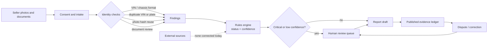
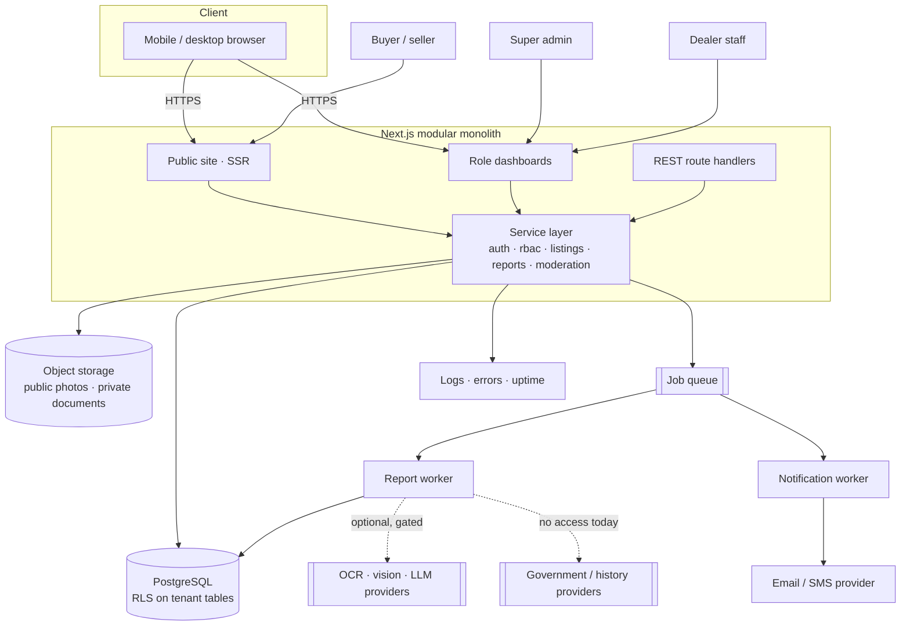
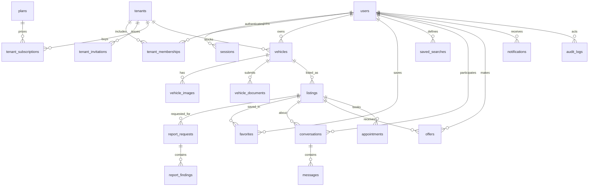

# AngkorEV — development plan for an evidence-first car marketplace in Cambodia

**Version:** 1.0 · **Date:** 20 October 2026 · **Status:** prototype built; production hardening and pilot validation next

This is the consolidated plan. It follows the required order: market, users, features, AI, UX, stack, architecture, data, API, security, money, roadmap, testing, launch, risk, KPIs, backlog. Deeper detail lives in [`01`–`07`](README.md); this document is the one to read first.

> **What already exists:** a working Next.js prototype in this repository — public marketplace, four role dashboards, 22-table schema, private document review, a deterministic evidence engine with five statuses, 31 API route handlers, and 18 passing security tests. It runs on SQLite with no billing, no external history provider and no OCR. Those are deliberate boundaries, not hidden gaps. §14 and §19 separate delivered from remaining work.

---

## 1. Executive summary

**The problem.** Buying a used car in Cambodia is an information problem before it is a price problem. A buyer sees photographs, a mileage number typed by the seller, and a price. There is no published residual-value guide and no auction clearing price; classifieds "reflect hope rather than fact" ([Khmer Times, 6 Aug 2026](https://www.khmertimeskh.com/501991289/what-new-car-depreciation-really-looks-like-in-cambodia/)). Documents may be genuine, incomplete or edited. The buyer cannot tell which statement is verified, which is merely claimed, and which nobody knows — so the rational behaviour is to distrust every listing equally, or to rely on a friend who "knows cars".

**The product.** AngkorEV is a multi-tenant marketplace where every listing carries an evidence ledger. Documents are uploaded privately and reviewed by a human; identifiers are checked for format and duplication; mileage, price and photos are compared against comparable listings. Each finding is published with one of five statuses — *verified by source, evidence found, potential inconsistency, not verified, no data available* — plus a confidence level and a source reference. Sellers get inventory, lead and staff tooling. Buyers get search, comparison, reports and a dispute path.

**The differentiator is honesty, not AI.** A report that says "we could not check accident history; here is what we did check" is more useful and more defensible than a score out of 100. No external registry, insurer or auction source is connected today, so those lines say `NO_DATA`. Nothing in the product converts that into "no accidents".

**Business model.** Dealer subscriptions ($29 Growth / $79 Pro, hypotheses), featured placement, and later a paid report. The platform never holds buyer funds, never offers escrow or split payments, and does not sell ranking. Reports are free during the pilot because charging before the review process is proven would create pressure to overclaim ([`05`](05-monetization.md)).

**Wedge and sequence.** Phnom Penh dealers first — they have repeated inventory, staff and a commercial reason to pay. Private sellers and buyers follow. Then provinces. Build order is marketplace MVP → evidence-based verification → revenue validation → AI infrastructure. That is also the order in which this repository was built.

**What "good" looks like at day 90.** Ten verified dealers, 150 published listings, 500 weekly buyer sessions, 100 delivered reports with a median turnaround under 24 hours and a dispute rate under 3%, and four dealers paying $29 after a free month. Those are provisional hypotheses, not benchmarks (§18).

**The ask.** Approve a 22–26 week plan with one full-stack engineer, a part-time designer and founder-led sales; fund legal review, managed Postgres and object storage before beta; and refuse to fund OCR or history-provider integrations until the revenue gates in §13 are met.

---

## 2. Business opportunity and Cambodian market research

Full source log: [`01-market-research.md`](01-market-research.md) (17 sources, dates shown). Numbers below are sourced; anything without a citation is an assumption and is labelled.

### 2.1 What the evidence says

| Finding | Evidence | Product implication |
|---|---|---|
| The fleet is large but overwhelmingly two-wheeled; cars are a minority | MPWT/UNESCAP data summarised in [`01`](01-market-research.md) §1.1 | Do not size the business from total registered vehicles |
| EVs are growing quickly from a small base: **6,174 registrations in H1 2026**, more than double H1 2025 (2,459) | [VietnamPlus, 14 Aug 2026](https://en.vietnamplus.vn/cambodia-moves-to-keep-pace-with-growing-ev-market-post350092.vnp) | EV content is a differentiator for a minority of listings, not the whole product |
| New cars passed used imports for the first time in 2025, at about **55% of the market**; Chinese brands rose from 12% to 29% share | [Khmer Times, 24 Jul 2026](https://www.khmertimeskh.com/501949266/as-cambodia-moves-to-new-cars-keep-the-used-car-instinct/) | The trust question shifts to "is this two-year-old car's history and battery what the seller says?" |
| There is **no auction house setting a weekly price and no published residual-value guide**; a BYD Atto 3 is about **$26,800 new** versus used listings from **$18,800** | [Khmer Times, 6 Aug 2026](https://www.khmertimeskh.com/501991289/what-new-car-depreciation-really-looks-like-in-cambodia/) | Price context is useful; a "valuation" would be an unsupported claim |
| Khmer24 has operated since 2009 and dominates general classifieds | [Khmer24](https://www.khmer24.com/c-cars-and-vehicles); [Tracxn, 3 Sep 2026](https://tracxn.com/d/companies/khmer24/__AfdE9L7lONFa7DzeMsAfzObMdU90YLe6Otc_KaFgoJM) | Compete on structure and evidence, not on listing count |
| Facebook had about **12.9 million Cambodian users** in early 2025 and remains the main social channel | [Khmer Times, 14 May 2025](https://www.khmertimeskh.com/501683396/over-72-of-cambodians-active-on-social-media-platforms/); [StatCounter, Sep 2026](https://gs.statcounter.com/social-media-stats/all/cambodia) | Distribution and re-engagement happen on Facebook/Telegram; the marketplace must be shareable |
| **68.48%** of individuals used the internet in 2025; mobile subscriptions exceed the population | [Cambodia Digital Economy & Business Committee](https://digitaleconomy.gov.kh/en/supporting-sector/digital-landscape) | Mobile-first, low-bandwidth, no decorative video or 3D in search |

**Data conflict to respect:** cumulative EV figures reported in 2026 range from 14,534 to 15,239 while H1 2026 alone is 6,174. Different sources use different cut-offs. Quote the source and treat totals as directional ([`01`](01-market-research.md) §1.2).

### 2.2 What we assume, and how to test it

| Assumption | Confidence | How to validate |
|---|---|---|
| Phnom Penh has enough dealers with 10+ used cars to seed 150 listings | Medium | Dealer interviews; count lots on Street 271 / Russian Blvd corridors |
| Dealers will pay $29/month after a free month | Low | E2 stop rule: ≥4 of 10 convert or 3 sign invoices |
| Buyers will request a report when it is free and explained clearly | Medium | Track report requests per listing view; target ≥5% |
| A human can review a document set in 8–12 minutes | Low | Time-track the first 100 reviews |
| Report review costs $0.40–0.80 | Derived | Recalculate from tracked time and loaded wage |
| Deposit scams are common enough to shape behaviour | Medium (qualitative) | Moderation cases; buyer interviews; never cite a rate we have not measured |

We do **not** have a reliable public estimate of annual used-car transactions, dealer count or average transaction price. No TAM/SAM/SOM figure is presented as fact. The bottom-up pilot model is in [`01`](01-market-research.md) §2.

### 2.3 Buyer behaviour and trust concerns

Observed channels (sourced) and reasonable inferences (labelled):

- Buyers browse Facebook groups, Telegram channels, Khmer24 and dealer showrooms. They shortlist on price and photos, then ask a friend or mechanic to inspect. **Assumption:** inspection is relationship-driven, not a standardized paid service.
- Sellers — especially private sellers — resist paying to list, because reach is currently free. **Assumption:** they will accept structured listings if it produces fewer, better inquiries.
- Dealers compete on trust signals they cannot prove: "no accident", "one owner", "full service". **Assumption:** a neutral evidence layer is more credible than another dealer badge, provided it is not sellable.
- Deposits are requested before viewing in many informal transactions. This is the highest-risk behaviour on the platform and the reason the product never facilitates holding funds.

### 2.4 Competitive position

| Competitor type | Strengths | Weaknesses we can exploit |
|---|---|---|
| **Khmer24** (general classifieds) | Brand, traffic, Khmer-first, free | Flat listings, no dealer workflow, no evidence layer, weak filters |
| **Facebook / Telegram groups** | Reach, zero friction, chat-native | No structure, no search, no accountability, scams disappear with the post |
| **Car-specific classifieds and apps** | Focused UX, some claim valuation/escrow | Claims are unverified from outside; escrow is a regulated activity, not a feature toggle |
| **Dealer websites / showrooms** | Trusted relationships, physical inspection | Small inventory, no cross-dealer comparison |

AngkorEV does not try to out-list Khmer24. It tries to be the place where a listing has a verifiable evidence trail and a dealer has a reason to keep inventory accurate. That is a narrower, more defensible position.

### 2.5 Launch strategy for a small budget

1. **City, not country.** Phnom Penh only. Province filters exist; supply does not.
2. **Dealer-first supply.** Ten to fifteen dealers, 10–20 cars each, hand-onboarded. Free for 30 days in exchange for complete documents and photos.
3. **Useful free tier.** Five listings, reports included, no crippled demo.
4. **Reports free at pilot.** Prove turnaround and comprehension before charging.
5. **Distribution through the channels people already use.** Every listing has a share image and a dealer QR code; Facebook and Telegram posts point back to the listing.
6. **No brand spend.** Direct sales, dealer co-marketing, Khmer SEO and educational content.

---

## 3. Product goals and measurable objectives

| Goal | Metric | Day-90 target (hypothesis) | Guardrail |
|---|---|---|---|
| Buyers understand the evidence model | % of tested users who correctly explain `NO_DATA` | ≥60% | <10% believe a report proves "no accidents" |
| Supply is real and complete | Published listings / verified dealers | 150 / 10 | ≥70% with 3+ photos and a document |
| Demand exists | Weekly buyer sessions | 500 | Search → detail click-through ≥25% |
| Listings convert to conversations | Inquiries per listing view | ≥3% | Seller first reply <24h in ≥70% of threads |
| Reports are used and trusted | Reports delivered / dispute rate | 100 / <3% | Median turnaround <24h |
| Revenue is validated | Paying dealers / MRR | ≥4 / ≥$120 | No discounting below $29 in the first cohort |
| The product is usable on Cambodian networks | p95 search response; LCP on emulated 3G | <800 ms; <2.5 s | No layout shift from images |
| Operations are safe | Open P0/P1 security defects; cross-tenant incidents | 0; 0 | Security suite green on every deploy |

**Non-goals for the first 90 days:** escrow, wallets, financing, insurance, native mobile apps, nationwide coverage, real-time chat, LLM-generated history, paid ranking of any kind.

---

## 4. Target audience and user journeys

| Group | Needs | Frustrations today | Platform benefit |
|---|---|---|---|
| **Individual buyer** | Compare real prices, avoid a bad car, talk to a responsive seller | Listings disappear; mileage and history are unverifiable; deposit pressure | Evidence summary, saved searches, comparison, safe-contact guidance |
| **Private seller** | Sell quickly at a fair price without spam | Free posts buried; repeated low offers; no structure | Guided listing, photo/document checklist, qualified inquiries |
| **Dealer** | Sell stock faster, manage staff, measure demand | Leads scattered across Facebook inboxes; no analytics; staff share one login | Inventory, leads, team roles, analytics, storefront |
| **Inspection / verification partner** | Predictable job flow, visible credibility | Discovered by word of mouth | Referral surface, appointment handoff (future) |
| **Admin / support** | See risk early, act consistently, keep records | Manual screenshots, no audit trail | Review queues, document verification, moderation cases, audit log |

### 4.1 Buyer searches for a used car

1. Lands on a Khmer or English page from Facebook/SEO → sees search with make, budget, province.
2. Filters by price and body type; results show photo, price, year, mileage, dealer and evidence counts.
3. Opens a listing; the top block separates *what we checked* from *what the seller says*.
4. Saves the car or requests a report before contacting anyone.
5. Shares the listing on Telegram if they want a second opinion.

**Removed steps:** account creation before search; a mandatory phone number to view; a separate "request brochure" form.

### 4.2 Buyer compares three vehicles

1. Adds up to three cars from results or detail pages.
2. `/compare` shows specifications side by side with best-price/lowest-mileage/newest markers.
3. Report row shows status, confidence, verified-record count and open inconsistencies — never a single score.
4. Removes a car and the table reflows; an empty comparison offers a route back to search.

**Removed:** PDF export at MVP; saving a comparison to an account (local storage is enough).

### 4.3 Buyer requests an evidence report

1. On a listing, selects "Check this car" → consent screen explains what is processed and what cannot be checked.
2. Request is created for that vehicle; duplicates in the last 24 hours return the existing report instead of charging twice.
3. Report states evidence counts, findings, sources and limitations; unclear items are `NO_DATA`, not guesses.
4. Buyer can dispute a finding; the dispute opens a moderation case and is visible to staff.

**Removed:** uploading someone else's documents; promising a completion time before reviewer capacity is measured.

### 4.4 Buyer contacts the seller and books a viewing

1. Inquiry form: message, intent (question/viewing), optional preferred time.
2. Server checks the listing is published and the buyer is not the seller; rate limit 20/hour.
3. Conversation is created; seller sees the lead in the dashboard and by email (Phase 2).
4. Buyer and seller arrange the viewing in-app; the platform reminds both to meet in a public place and inspect documents.
5. No deposit is collected. Safety copy warns against advance transfers.

### 4.5 Private seller publishes a listing

1. Register with email; verify nothing until publishing (verification is required only for payouts/featured, which do not exist yet).
2. Four-step wizard: car → photos → documents (optional) → price and contact.
3. Draft is saved; publishing requires make, model, year, price, province and at least one photo.
4. Listing goes to `PENDING` for moderation, then `PUBLISHED` or `REJECTED` with a reason.
5. Seller sees views, saves and inquiries; can mark sold or archive.

**Removed:** mandatory VIN at draft stage (many sellers do not have it to hand); a separate payment step.

### 4.6 Dealer manages inventory

1. Owner invites staff by email with a role; invitation is bound to that email and expires in seven days.
2. Inventory manager creates listings; sales agents see leads but cannot change roles or billing.
3. Leads show buyer, car, intent and age; stale leads are flagged.
4. Analytics shows views, saves, inquiries, report requests and top listings.
5. Owner reviews team activity and subscription quota.

**Removed:** per-seat pricing (not yet); CSV import at MVP; a separate dealer app.

### 4.7 Admin reviews a suspicious listing

1. Queue sorted by risk: reported content, critical report findings, duplicate VIN/photo, unverified dealers.
2. Admin opens the case, sees the listing, evidence, reporter and history in one screen.
3. Actions: request changes, hide, reject, suspend seller, suspend tenant, dismiss. Every action asks for a reason and writes an audit entry.
4. Reporter receives an outcome notification (Phase 2); the listing owner sees the reason.

**Removed:** deleting evidence; editing a finding without a reviewer note.

---

## 5. Feature matrix

Status: **●** delivered in this repository · **◐** partial · **○** planned.

| Module | MVP (this repository) | Phase 2 — pilot hardening | Future |
|---|---|---|---|
| Accounts and roles | ● Email/password, sessions, 8 roles, staff and customer dashboards | ○ OTP phone verification, email verification, account recovery | SSO for dealer groups |
| Tenant model | ● Tenants, memberships, invitations, suspension | ○ RLS, per-tenant branding, seat limits | Multi-branch tenancy |
| Listings | ● CRUD, wizard, drafts, moderation states, sold/archived, expiry, duplicates | ○ Scheduled publishing, bulk import | Dealer CRM sync |
| Media | ● Multi-photo upload, gallery, private document upload | ○ Presigned S3/R2, AVIF pipeline, video links | 360° and inspection media |
| Search | ● Filters, sort, facets, Khmer/English UI, pagination | ○ Typo tolerance, synonyms, saved-search alerts | Natural-language search |
| Compare | ● Up to three cars, local persistence | ○ Shareable comparison link | AI summary of differences |
| Messaging | ● Conversations, messages, unread state, safety copy | ○ Email notifications, attachments | Real-time chat |
| Appointments and offers | ● Viewing requests, offers, statuses | ○ Calendar handoff, reminders | Partner inspection booking |
| Reports | ● Rules engine, five statuses, confidence, review, dispute | ○ Queue/worker, OCR, source adapters | Provider-backed history |
| Verification | ● Document review, VIN/photo/price/mileage checks | ○ Dealer business verification, reviewer SLAs | Inspection-network attestations |
| Moderation | ● Reports, cases, suspend tenant/user, audit | ○ SLA timers, appeals, reuse detection at scale | Automated fraud scoring |
| Dealer tools | ● Inventory, leads, team, analytics, settings | ○ Billing, featured purchase, exports | Multi-location analytics |
| Admin | ● Tenants, listings, documents, reports, users, audit | ○ Billing ops, refunds, compliance exports | Trust & safety console |
| Billing | ○ Plans and quotas in data; no payment | ○ Invoiced subscriptions via licensed PSP | Card and KHQR collection |
| Analytics | ◐ Dashboard counts from the database | ○ Consent-safe event funnel | Cohort and retention models |
| i18n | ● Khmer/English dictionary, cookie persistence, Khmer font | ○ Native review, SEO alternates | Additional languages |
| Accessibility | ◐ Semantic HTML, focus styles, contrast tokens | ○ axe audit and fixes | WCAG 2.2 AA certification |

### 5.1 Feature briefs

| Feature | Business value | User benefit | Technical dependencies | Effort | Acceptance criteria |
|---|---|---|---|---|---|
| **Accounts and tenant roles** | Makes dealer teams and separation sellable; enables every other permission | One login, the right dashboard, no cross-dealer leakage | Schema, session auth, RBAC | L (built) | Eight roles enforced server-side; invitation bound to email; tests pass |
| **Listing creation and moderation** | Creates the inventory the marketplace sells | Publish from a phone in minutes with a clear checklist | Auth, uploads, schema, moderation queue | L (built) | Draft → pending → published/rejected; reason shown; duplicate slug/VIN detected |
| **Search and filters** | Converts inventory into sessions and leads | Finds a relevant car in three taps on 3G | Indexed schema, query builder, i18n | L (built) | Filters combine, facets correct, p95 <800 ms, no stale/sold cars |
| **Compare** | Differentiates from flat classifieds; increases return visits | Sees trade-offs without opening five tabs | Search data, report summary API | M (built) | Max 3 published cars; evidence counts shown; documents never exposed |
| **Inquiries and messaging** | Turns interest into measurable demand | Contacts a seller without publishing a phone number | Auth, rate limits, notifications | M (built, email pending) | Inquiry creates one conversation; seller cannot be the buyer; spam limited |
| **Evidence report** | Core differentiator and future paid product | Knows what was checked, what failed and what is unknown | Documents, review, rules engine, report UI | L (built, queue pending) | Five statuses, confidence, source, limitations, dispute; banned claims impossible |
| **Dealer verification** | Justifies dealer subscription and trust badge | Distinguishes a real business from a disposable account | Admin workflow, document review | M (next) | Business document reviewed; badge meaning explained; revocation audited |
| **Billing and featured placement** | First real revenue; validates willingness to pay | Clear invoice, no card data on the platform | Legal, PSP contract, plan quotas | L (next) | Invoice paid via hosted PSP; quota and featured expiry enforced; refunds recorded |
| **Moderation and audit** | Protects buyers and limits legal exposure | Faster removal of scams and abusive sellers | Reports, cases, roles, audit log | M (partial) | Case owner and SLA; reason required; every action in the audit trail |

---

## 6. AI vehicle history and inspection architecture

### 6.1 The rule

The system **analyses evidence it holds**. It does not infer history from a model's memory, does not fill gaps with plausible text, and does not convert absence of records into a negative finding. When a source is unavailable, the finding is `NO_DATA` — which means "we could not check", never "nothing happened".

### 6.2 Pipeline



The prototype implements the solid path: intake → checks → findings → review → report → dispute. The dashed path is deliberately empty; a provider adapter must return `NO_DATA` when it has no lawful access.

### 6.3 Vehicle identification

| Identifier | What it is | How it is used | Failure handling |
|---|---|---|---|
| **VIN / chassis number** | 17-character manufacturer identifier (format varies by market and age) | Format validation, duplicate check across active listings, consistency with documents | Invalid → `POTENTIAL_INCONSISTENCY`; missing → `NO_DATA` |
| **Registration plate** | Local plate, may change on transfer | Duplicate check, document consistency | Masked in public UI; full value only in the report |
| **Registration document** | Ownership and registration record | Human review of holder name, plate, VIN, year | Name mismatch → reviewer note, not an accusation |
| **Make/model/year** | Seller-declared attributes | Cross-check against documents and photos | Conflicting year → inconsistency finding |

Public pages mask VIN and plate (`JTDK••••••3456`). Full identifiers appear only inside an authorized report. The product explains the difference between chassis number, VIN, plate and registration rather than treating them as synonyms.

### 6.4 Data sources — feasibility, not assumptions

| Source | Access today | Cost | Reliability | Legal constraint | Integration |
|---|---|---|---|---|---|
| **Government vehicle registry (MPWT)** | No public API identified | Unknown | Authoritative if access granted | Data-sharing agreement likely required | Research and negotiate; manual verification in the meantime |
| **Licensed history providers** | Not assumed; Cambodia coverage unclear | Per-query, unknown | Varies by market | Contract and cross-border transfer review | Adapter interface only after contract |
| **Dealer maintenance records** | Dealer-provided PDFs/photos | Review time | Good when genuine | Consent from dealer and owner | Upload + human review |
| **Inspection centres** | Partner-dependent | Per inspection | Good for condition, not history | Commercial agreement | Referral or API later |
| **Seller documents** | Available now | Review time | Can be forged | Consent, minimization, retention limits | Implemented |
| **Marketplace history** | Available now | Compute only | Weak alone; strong for duplicates | Privacy notice must cover it | Implemented in rules |

**Do not assume** that MPWT, insurers, auctions or foreign history services expose APIs to a startup. Each row is a negotiation and legal question before it is an engineering ticket.

### 6.5 Report structure

Each finding carries:

`code` · `label (km/en)` · `status` · `confidence 0–100` · `severity` · `source reference` · `observed date` · `reviewer` · `seller claim vs platform observation` · `plain-language note`

The report groups findings into **identity**, **ownership and registration**, **documents**, **mileage**, **price context**, **photos**, **inspection availability**, and **unknowns**. The summary shows counts per status and the attention level, never a single "safety score".

### 6.6 Status semantics

| Status | Means | Does not mean |
|---|---|---|
| `VERIFIED_BY_SOURCE` | A document or authoritative source confirmed the item | The whole car is genuine |
| `EVIDENCE_FOUND` | Consistent evidence exists, but it is not authoritative | Independently proven |
| `POTENTIAL_INCONSISTENCY` | Two pieces of evidence conflict, or a check failed | Fraud proven |
| `NOT_VERIFIED` | We have the item but could not check it | False |
| `NO_DATA` | No source is available or nothing was submitted | No accidents, no mileage tampering, no finance |

### 6.7 Technology strategy

| Technique | Use | Recommendation | Gate |
|---|---|---|---|
| **Rules validation** | VIN format, year/plate consistency, duplicate VIN, price/mileage outliers | Build first; deterministic, explainable, cheap | Now — implemented as `rules-v1` |
| **Image hashing** | Duplicate or reused listing photos | Build first; no model needed | Now — implemented |
| **OCR / document extraction** | Pull plate, VIN, holder, dates from documents | Buy a document-AI API; never auto-verify without a human | G2: ≥300 reports/month |
| **Vision model** | Visible damage, missing parts, photo quality | Assistive only; show as observation with confidence | G2 plus accuracy test on 200 labelled photos |
| **Anomaly detection** | Suspicious mileage rollbacks, price outliers | Start with transparent heuristics; add models with data | After 1,000 listings |
| **LLM summarisation** | Turn structured findings into readable Khmer/English | Constrained to provided findings; template fallback | G3, and only with no new facts |
| **Custom history model** | Predict accidents | **Do not build.** No lawful labelled dataset, no defensible accuracy | Not planned |

**Buy vs build:**

| Option | Cost | Latency | Accuracy | Privacy | Maintenance | Verdict |
|---|---|---|---|---|---|---|
| **Commercial OCR/vision API** | Per page/image, low at pilot volume | 1–5 s per call | Strong on printed documents; weaker on Khmer handwriting | Data leaves the country — contract required | Vendor-managed | Buy **after** consent and transfer review |
| **Open-source OCR/vision, self-hosted** | GPU or CPU time; engineering time | Predictable, but slower without GPUs | Needs tuning on Cambodian documents | Data stays in our environment | We own upgrades and failure modes | Only if volume or privacy makes APIs untenable |
| **Hybrid (recommended)** | API for hard documents, rules for everything deterministic | Mixed | Best available with human confirmation | Minimised payloads, no retention by vendor | Moderate | Use in Phase 3+ behind a feature flag |
| **Custom history model** | Data collection, labelling, training | — | No lawful labelled dataset | — | High | **Do not build** |

**Buy vs build:** buy OCR/vision capacity per call; keep the evidence schema and decision logic in-house. A provider abstraction (`src/lib/providers`) prevents lock-in and makes "no provider" a valid state.

### 6.8 Safety and quality controls

- Consent before document processing; plain-language explanation of purpose and retention.
- Minimise and mask personal data; documents stored outside the public root, access logged.
- Encrypt in transit and at rest; signed, short-lived URLs in production.
- Role-checked report access: requester, seller, tenant staff, platform staff only.
- Confidence and source shown on every finding; low confidence goes to review.
- A reviewer cannot delete a finding; they can add a note and change status with an audit entry.
- Dispute path creates a case and a correction trail.
- Banned phrases ("accident-free", "verified history", "clean title") are blocked in generated copy and tested.
- No claim that identity verification implies vehicle quality.

### 6.9 MVP path

1. Document intake + human review (done).
2. Rules checks + duplicate detection (done).
3. Report UI with limitations and dispute (done).
4. Reviewer workflow and SLA (partial).
5. OCR assistance (blocked by gate).
6. Provider integrations (blocked by contracts).

---

## 7. UI/UX design system and page specifications

### 7.1 Principles

Mobile-first at 360 px; one primary action per screen; evidence before decoration; Khmer and English never share a fixed-height container; no autoplay video, parallax or 3D in search or listing flows; every empty state explains the next step.

### 7.2 Design tokens and components

| Element | Decision |
|---|---|
| Type | **Inter** for Latin, **Noto Sans Khmer** for Khmer, bundled locally (no Google Fonts request) |
| Colour | Ink neutrals, deep teal brand, gold accent for caution; semantic success/warn/danger; all text ≥4.5:1 |
| Spacing | 4/8 px scale; 16 px page gutters at 360 px; 12-column grid above 1024 px |
| Targets | 44×44 px minimum; visible focus ring; skip link; logical heading order |
| Components | Button, input, select, textarea, card, badge, alert, empty state, skeleton, pagination, tabs, table, sheet/dialog |
| States | Loading skeletons for cards and tables; inline field errors; success toast; destructive confirmation with a reason |
| Imagery | 4:3 cards, 16:9 gallery, `loading="lazy"` below the fold, explicit width/height to prevent shift |
| Language | Cookie-persisted locale; `<html lang>` reflects the choice; numerals and USD/KHR formatting per locale |
| Theme | Light theme only; dark mode is deferred because it doubles contrast testing for little pilot value |

### 7.3 Page specifications

| # | Page | Layout and components | Key interactions | Responsive and states |
|---|---|---|---|---|
| 1 | **Home** | Search bar, trust explanation, featured cars, recent listings, dealer CTA | Search submits to `/cars`; filter chips for make and province | Grid 1/2/3 columns; skeleton cards; no-results links to all cars |
| 2 | **Search results** | Sticky filter summary, filter sheet on mobile, result cards, sort, pagination | Filters apply to the URL; chips removable; compare add | Filter drawer under 768 px; empty state suggests widening price or year |
| 3 | **Vehicle detail** | Gallery, price + KHR, spec grid, evidence summary, seller card, safety note, similar cars | Save, compare, request report, contact seller | Sticky contact bar on mobile; gallery fallback; sold/draft banner for owner |
| 4 | **Report** | Status counts, attention level, findings list, sources, limitations, dispute | Expand a finding; open source; dispute | Readable single column; private message when unauthorized; print-friendly |
| 5 | **Compare** | Sticky first column, up to three car columns, best markers | Add/remove; clear; open listing | Horizontal scroll with sticky labels; empty state |
| 6 | **Dealer storefront** | Cover, verification badge, about, inventory grid, contact | Filter by make; call/chat | Suspended or unknown tenant → 404 |
| 7 | **Listing wizard** | Four steps: car, photos, documents, price; progress; save draft | Validate per step; autosave; preview | Single column; resume draft; explicit "why we ask" help |
| 8 | **Buyer dashboard** | Favourites, saved searches, reports, appointments, messages | Remove favourite; open report; cancel appointment | Tabs collapse to list; empty states |
| 9 | **Seller dashboard** | KPI cards, listing table, recent leads, quick actions | Publish, mark sold, edit, view leads | Cards stack; table scrolls |
| 10 | **Dealer inventory** | Status tabs, search, quota indicator, per-row actions | Bulk status changes; feature request | Filters in sheet; empty state offers the wizard |
| 11 | **Messages / appointments** | Conversation list + thread; appointment cards; safety banner | Send, report, block, propose time | Thread replaces list on mobile; unread dot |
| 12 | **Billing status** (Phase 2) | Current plan, invoices, featured purchases | Download invoice; change plan | No card fields in the prototype; hosted PSP page |
| 13 | **Admin** | Queue counts, tenant and listing tables, document preview, case detail | Verify, suspend, dismiss, with mandatory reason | Tables scroll; actions in a drawer; audit link on every row |
| 14 | **Auth and settings** | Login, register, invite acceptance, profile, language, deletion request | Next-URL redirect; invite bound to email | Inline errors; no account enumeration |
| 15 | **Language switch** | Header control, cookie, return to same page | Persist choice; update `lang` | No layout shift; Khmer line-height tested |

### 7.4 Prototyping before development

Figma (or Penpot) with two frame sets — 360 px and 1280 px — for the seven critical screens: home, results, detail, report, wizard, dealer dashboard, admin case. Build a token page first (type, colour, spacing, components), then clickable flows with **real Khmer copy**, not lorem ipsum. Test five buyers and three dealers on: find a car under $20,000, understand a `NO_DATA` finding, publish a listing, and find a lead. Record task completion and comprehension; fix wording before visual polish. Handoff includes tokens, states (loading/empty/error), and copy keys, not screenshots alone.

---

## 8. Recommended technology stack

| Layer | Recommendation | Why | Alternatives considered |
|---|---|---|---|
| **Frontend** | Next.js 15 App Router, React 19, TypeScript strict | Server rendering for slow networks, one language across UI and API, fast iteration | Remix, SvelteKit, plain React SPA (worse first load) |
| **Styling** | Tailwind CSS 4 + small component layer | Consistent tokens, tiny CSS, no runtime cost | CSS Modules, MUI (heavier) |
| **API** | Next.js route handlers, REST + JSON | Modular monolith; no separate deployable at MVP | Spring Boot 3 / Java 21, Laravel, Rails |
| **Database** | PostgreSQL 16 in production; SQLite/libSQL in the prototype | Transactions, constraints, RLS, mature backups | MySQL, MongoDB (weaker relational integrity) |
| **ORM** | Drizzle | Typed SQL, explicit schema, no codegen binaries | Prisma (blocked in the build environment), Kysely |
| **Validation** | Zod | Shared request schemas, typed errors | Yup, io-ts |
| **Auth** | Session cookie + scrypt password hashes; server-side membership lookup | Simple, revocable, no JWT storage in the browser | Auth0/Clerk (cost, data residency), JWT-only |
| **Files** | S3-compatible object storage; presigned uploads; private document bucket | Removes app-server writes; lifecycle rules | Local disk (prototype only) |
| **Jobs** | Postgres-backed queue (pg-boss) or BullMQ/Redis | Report processing, email, retention | Kafka, SQS (unnecessary at pilot) |
| **Email** | Transactional provider with Khmer support | Invitations and alerts | Self-hosted SMTP (deliverability risk) |
| **AI** | Provider abstraction; OCR/vision per call; no training | Cost control, replaceable vendors, privacy review per provider | Single-vendor lock-in |
| **Testing** | Vitest, Playwright, axe | Fast unit tests, real browser paths, accessibility | Cypress |
| **Observability** | Structured logs, error tracking, uptime checks | Small team needs alerting, not dashboards | Full APM at pilot |
| **Hosting** | One container host + managed Postgres + CDN; Singapore region | Low latency to Cambodia, predictable cost | Kubernetes (premature), serverless cold starts |

**Why TypeScript over Spring Boot.** The specification suggests Java 21 + Spring Boot. It is an excellent choice for a bank or a team that already runs Java. Here, one full-stack developer must ship UI, API, jobs and admin; a single typed language removes an integration layer and halves the context switching. The modular boundaries that matter — identity, tenancy, listings, evidence, moderation, billing — are enforced by folders and service functions, so a future extraction into services is possible without a rewrite.

**Cost shape at pilot (assumptions):** managed Postgres $15–30, object storage and CDN $10–25, hosting $20–40, email $10–20, error tracking free tier, AI $0 until OCR is enabled. Target infrastructure under $100/month before revenue.

**Cambodia-specific:** serve from Singapore, compress images aggressively, avoid third-party scripts on search pages, and test on a throttled 3G profile. Khmer fonts are self-hosted subsets; a font CDN request is a visible delay on a weak connection.

---

## 9. System architecture



Boundaries: public rendering never touches private storage; the report worker is the only component allowed to call AI providers; provider adapters are the only place a history source can be reached; every tenant-scoped query receives a tenant id from the session, not the request body.

---

## 10. Data model and entity relationship diagram

Twenty-two tables in the prototype. Grouped:

- **Identity and tenancy:** `users`, `sessions`, `tenants`, `tenant_memberships`, `tenant_invitations`.
- **Commercial:** `plans`, `tenant_subscriptions`.
- **Inventory:** `vehicles`, `vehicle_images`, `vehicle_documents`, `listings`.
- **Evidence:** `report_requests`, `report_findings`.
- **Demand:** `favorites`, `saved_searches`, `conversations`, `messages`, `appointments`, `offers`.
- **Platform:** `notifications`, `reported_content`, `audit_logs`.

Key constraints: unique `users.email`; unique (`user_id`, `tenant_id`) membership; unique invitation token; unique listing slug; unique report `public_id`; foreign keys with `ON DELETE CASCADE` only where ownership is absolute; audit rows are append-only and never cascade from a user.



**Deliberate simplifications:** one `vehicles` row per physical car rather than separate specification tables (`engineCc`, `transmission`, `fuelType` are columns); `seller_profiles` folded into `users` + optional `tenants`; no `payments` table until a PSP is contracted; no `reviews` table until verified transactions exist at volume. This avoids the duplicated entities common in marketplace schemas while leaving room to add them.

**Privacy:** documents are metadata rows pointing at private object keys; the bytes never live in the database or in `/public`. Report findings store a source reference, not a copy of the source document.

---

## 11. Representative REST API design

**Conventions.** JSON only; `{ "data": ... }` on success and `{ "error": { code, message, details, requestId } }` on failure; `422` for validation; `401` unauthenticated; `403` authenticated but not allowed; `404` for resources the caller may not know about; `409` for state conflicts; `429` with `Retry-After`. Cursor or page pagination with a hard cap (50). All mutations validated by Zod. Tenant scope comes from the session membership; a `tenantId` in a body is either ignored or rejected.

| Area | Representative endpoints | Authorization |
|---|---|---|
| Auth | `POST /api/auth/register`, `POST /api/auth/login`, `POST /api/auth/logout` | Public (rate-limited) |
| Listings | `GET/POST /api/listings`, `GET/PATCH/DELETE /api/listings/[id]`, `POST .../publish`, `.../sold`, `.../feature` | Public read for published; owner or tenant staff for write |
| Search | `GET /api/listings?q=&make=&maxPrice=&page=` | Public |
| Compare | `GET /api/listings/compare?ids=a,b,c` | Public, published only, max 3 |
| Media | `POST /api/uploads`, `POST /api/listings/[id]/documents`, `GET /api/documents/[id]` | Authenticated; document access owner/staff/moderation |
| Demand | `POST/DELETE /api/favorites`, `POST /api/inquiries`, `POST /api/offers`, `POST /api/appointments` | Customer, rate-limited |
| Reports | `POST /api/reports`, `GET /api/reports/[publicId]`, `POST .../dispute` | Requester, seller, tenant staff, platform staff |
| Tenant | `GET/PATCH /api/tenant/settings`, `POST /api/tenant/invitations`, `PATCH /api/tenant/members/[id]` | `tenant:manage` / `member:manage` |
| Admin | `GET /api/admin/tenants`, `PATCH /api/admin/tenants/[id]`, `PATCH /api/admin/documents/[id]`, `PATCH /api/admin/reports/[id]` | Platform staff; some actions super-admin only |
| Health | `GET /api/health` | Public, no internals |

**Example — request a report**

```http
POST /api/reports
Content-Type: application/json

{ "listingId": "lst_01J...", "consent": true }
```

```json
{
  "data": {
    "publicId": "AEV-RPT-7K2QM",
    "status": "QUEUED",
    "listingId": "lst_01J...",
    "estimatedDelivery": "within 24 hours during the pilot"
  }
}
```

**Example — denied access**

```json
{
  "error": {
    "code": "FORBIDDEN",
    "message": "You do not have access to this report.",
    "details": null,
    "requestId": "req_8f2c1a"
  }
}
```

**Rate limits (prototype defaults):** login 12 per 10 minutes per IP and 6 per 10 minutes per IP+email; uploads 40 per 10 minutes; inquiries 20 per hour; reports 10 per day; generic writes 120 per 10 minutes. These are starting values to tune, not claims about attacker behaviour.

**Error codes clients must handle:** `VALIDATION_ERROR`, `UNAUTHENTICATED`, `FORBIDDEN`, `NOT_FOUND`, `CONFLICT`, `RATE_LIMITED`, `INVITE_NOT_FOUND`, `INVITE_USED`, `INVITE_EXPIRED`, `TENANT_SUSPENDED`, `EMAIL_MISMATCH`, `ALREADY_MEMBER`, `QUOTA_EXCEEDED`.

---

## 12. Security, privacy and Cambodian regulatory review

> **Not legal advice.** This is an engineering checklist of questions for qualified Cambodian counsel. Several public sources are secondary and rules change by prakas and notification. Full detail and source links: [`04-regulatory-checklist.md`](04-regulatory-checklist.md).

### 12.1 Security controls

| Area | Control in the build | Production requirement |
|---|---|---|
| Authentication | Scrypt hashes, random session tokens stored hashed, `HttpOnly` + `SameSite` cookies, expiry and revocation | Email verification, optional OTP, rotation, breach-password checks |
| Authorization | Server-side `canPlatform` / `canInTenant` / `canAccessListing`; layout guards; tenant resolved from membership | Same, plus RLS as defence in depth |
| Tenant isolation | Every query scoped by resolved tenant; spoofed `tenantId` rejected; suspended tenant loses all permissions | RLS policies and a test that runs as a restricted DB role |
| Uploads | Size/type allow-list, server-generated names, private directory outside `public/`, SHA-256 recorded | Presigned direct-to-bucket, malware scan, MIME sniffing, quotas |
| Documents | Streamed through an authorized route with `no-store`; no public URL | Short-lived signed URLs, access logs, watermarking on download |
| Reports | Requester, seller, tenant staff or platform staff only; disputes authenticated | Same plus rate-limited enumeration defence |
| Input | Zod schemas, parameterised SQL, output encoding | CSP, dependency scanning, SAST |
| Abuse | Login, upload, inquiry and report rate limits; moderation reports | Shared limiter, device signals, blocklists |
| Secrets | Server-only env vars; none referenced in client components | Secret manager, rotation, least-privilege keys |
| Audit | Append-only `audit_logs` for role, tenant, document and report actions | Tamper-evident retention, export for counsel |
| Recovery | Seed and schema scripts; SQLite backup in dev | Automated backups, restore drills, documented RTO/RPO |

### 12.2 Threat model and test evidence

| Threat | Example | Control | Test |
|---|---|---|---|
| Cross-tenant read | Dealer A guesses a listing or lead id from Dealer B | Session-derived tenant, scoped queries, `403` | `tests/security.test.ts` |
| Role escalation | Sales agent promotes themselves to owner | Role changes require `member:manage`; self-change blocked | 409 test |
| Suspension bypass | Suspended dealer keeps publishing or accepting invites | Membership resolution returns null; listings hidden | Search and invite tests |
| Document IDOR | Guessing `/api/documents/{id}` | Owner/staff/moderation check, `no-store` | 403 and 200 tests |
| Report scraping | Enumerating public report ids | Access check; random ids; rate limits | Dispute-authorization tests |
| Upload abuse | Oversized or executable file | Type/size allow-list, non-public storage | Upload handler validation |
| Invite forwarding | Someone else accepts an invitation | Email binding, expiry, single use | `EMAIL_MISMATCH` test |
| Spoofed tenant context | `tenantId` in request body | Body value ignored or rejected | 403 test |

### 12.3 Regulatory checklist

| Topic | What the sources indicate | Product action | Status |
|---|---|---|---|
| **Entity and tax** | A marketplace contracting with dealers needs a registered entity, GDT registration and patent tax | Incorporate before charging; separate platform and dealer funds | Counsel |
| **E-commerce intermediary** | Law on Electronic Commerce (2019) covers records, signatures, intermediary duties and consumer information (Art. 29) | Publish legal identity, terms, complaint route; retain electronic acceptances | Counsel: does a specific permit apply? |
| **Consumer protection** | Consumer Protection Law (2019) applies to traders dealing with consumers | No misleading "verified" claims; USD and KHR shown; correction and complaint path; do not disclaim statutory rights | Counsel review of terms |
| **Data protection** | Article 32 of the E-Commerce Law requires reasonable safeguards and correction/deletion; no comprehensive standalone statute identified | Privacy notice in both languages, purpose limitation, retention, data-subject requests | Counsel: confirm draft law status |
| **Cross-border processing** | Sending documents to an overseas OCR/LLM provider is a transfer | No external processing until contract and transfer review | Blocks OCR until approved |
| **VAT** | Standard VAT is 10%; e-commerce rules from 1 Apr 2022, with simplified registration thresholds for **non-resident** suppliers (KHR 250m annual / KHR 60m over three months) | Invoice platform services in USD; confirm treatment of subscriptions, featured and reports with an accountant | Counsel/accountant |
| **Payments** | Payment facilities are reserved to licensed institutions under the 2017 NBC Prakas; single-purpose e-money has notification thresholds and a 4 Nov 2026 notification date | Never hold funds, no wallet, no escrow; use a licensed PSP if collection is added | Implemented by omission |
| **Advertising** | Comparative or absolute claims need evidence; "accident-free" is unprovable here | Banned-phrase list; no paid ranking; report limitations visible | Implemented |
| **Vehicle registration/transfer** | MPWT publishes procedures; sources conflict on transfer deadlines | Link to MPWT; do not state deadlines; no "we handle transfer" claim | Counsel/verify |
| **History data** | No government or insurer API identified; coverage of foreign providers in Cambodia unconfirmed | `NO_DATA` when unavailable; contracts before integration | Implemented |

### 12.4 Questions for counsel

1. Does our model require an e-commerce intermediary permit beyond company and tax registration?
2. What consumer-information and cancellation rights apply to dealer subscriptions and paid featured placement?
3. Does processing registration documents require explicit consent, and what retention period is defensible?
4. May we send document images to an overseas OCR provider, and what contractual terms are required?
5. Is a paid vehicle report a "service" with specific advertising or liability constraints?
6. How should USD pricing and KHR display be invoiced, and what VAT treatment applies to each revenue stream?
7. What are the current ownership-transfer steps and deadlines (sources conflict)?
8. If we later add inspection bookings or financing referrals, what licences or partner arrangements apply?

### 12.5 Claims we will not make

No "accident-free", "clean history", "verified by the government", "guaranteed", "escrow-protected", "safe payment", or "identity verified therefore trustworthy". Identity and document checks describe what was checked and when — nothing more.

---

## 13. Monetisation and illustrative scenarios

> Prices, costs and volumes below are **hypotheses**. None is a measured willingness-to-pay figure or a market forecast. Validation rules are pre-registered in [`05-monetization.md`](05-monetization.md).

### 13.1 Principles

Never sell trust or ranking; charge the side with repeat demand (dealers); do not hold customer money; validate revenue before buying AI capacity.

### 13.2 Streams

| Stream | Payer | Status | Hypothesis |
|---|---|---|---|
| **R1 Dealer subscription** | Dealer | Plans and quotas modelled; no billing | $29/month up to 30 listings; $79 up to 100 |
| **R2 Featured listing** | Dealer / seller | Field and action exist; no payment | $5 per 7 days, capped by plan |
| **R3 Premium report** | Buyer / dealer | Free in pilot | $3–5 after turnaround and dispute gates |
| **R4 Verification/onboarding** | Dealer | Free in pilot | $20–50 one-off only if a real review is performed |
| **R5 Lead fees** | Dealer | Not implemented | Rejected at pilot: conflicts with subscription, rewards volume over quality |
| **R6 Aggregated data** | Banks/insurers | Not implemented | Only anonymised aggregates with legal review |

**Rejected:** escrow fees, financing commissions, insurance referrals, paid removal of flags, paid "verified" badges, selling personal data.

### 13.3 Collection options to evaluate (no capability assumed)

The prototype takes no money. Before Phase 4, obtain current merchant documentation from at least two providers and record terms in [`04`](04-regulatory-checklist.md). Candidates commonly used by Cambodian businesses include **ABA PayWay**, **ACLEDA**, **Wing**, **Pi Pay** and **Chip Mong**; presence in the market is not evidence that a given product supports our use case.

| Requirement | Question for each provider | Why it matters |
|---|---|---|
| **KHQR** | Do you offer merchant collection through KHQR, and what is the settlement flow? | KHQR is the national QR standard operated by the National Bank of Cambodia; confirm current participation directly |
| **Recurring invoices** | Can you invoice a registered business monthly in USD without storing card data on our side? | Subscriptions are the primary revenue stream |
| **Refunds and chargebacks** | Who bears the loss, and what evidence is required? | Determines pricing and support load |
| **Split payments / escrow** | Explicitly out of scope until separately licensed and contracted | Holding funds may require an NBC licence |
| **Fees and settlement time** | Published rate, fixed fee, FX and T+ settlement | Unit economics depend on it; do not quote unverified rates |
| **Data and reporting** | Webhook format, reconciliation export, tax invoice support | Needed for accounting and VAT |

If no provider offers a workable invoiced subscription flow, the pilot invoices manually by bank transfer and records payment status in the admin dashboard. That is slower but keeps the product live without holding funds.

### 13.4 Scenarios at month 12

| Line | Conservative | Base | Optimistic |
|---|---|---|---|
| Paying dealers (Growth / Pro) | 12 / 2 | 40 / 10 | 100 / 30 |
| Subscription revenue | $506 | $1,950 | $5,270 |
| Featured (units × $5) | 10 → $50 | 50 → $250 | 150 → $750 |
| Paid reports (units × price) | 0 | 100 × $3 = $300 | 400 × $4 = $1,600 |
| **Gross monthly revenue** | **$556** | **$2,500** | **$7,620** |
| Hosting, storage, email | −$40 | −$120 | −$400 |
| Report review cost | $0 (free tier) | −$60 | −$240 |
| Payment fees (3%) | −$17 | −$75 | −$229 |
| **Contribution before salaries** | **~$499** | **~$2,245** | **~$6,751** |
| Support assumed | founder | 0.5 FTE | 1.5 FTE |

Assumptions: every dealer starts on a 30-day free trial; 40–60% convert; featured attach is 20–30%; report review takes 8–12 minutes at $2.50–4.00/hour loaded; hosting scales with storage and AI calls. The conservative case does **not** cover a salary — that is the point of the pilot, not a failure of the model.

### 13.5 The smallest testable model

Ten dealers, one city, free for 30 days, then a written $29 offer. Reports free. No paid acquisition. If fewer than four convert, do not build billing infrastructure; test per-report pricing or a dealer inventory tool instead. The gates:

- **G1:** ≥10 paying dealers → hire a reviewer.
- **G2:** ≥300 reports/month → add OCR assistance.
- **G3:** ≥$3,000 MRR → pursue history-provider integrations.
- **G4:** dispute rate <3% and ≥90% within 24h → charge for reports.
- **G5:** featured attach ≥20% → build self-serve purchase.

---

## 14. Roadmap and milestones

**Team assumption:** one full-stack engineer, a designer at 50%, founder as product/sales, and a part-time document reviewer from Phase 3. With one developer alone, add roughly 50% to every phase and drop parallel legal work to the founder.

Weeks below are **estimates, not commitments**. They assume the team above, no blocking legal finding, and no external provider integration.

| Phase | Weeks | Deliverables | Acceptance criteria | Status |
|---|---|---|---|---|
| **0 — Discovery and validation** | 1–3 | 12–15 dealer interviews, 10 buyer interviews, competitor teardown, provider and legal feasibility, clickable prototype | ≥8/15 dealers rank lead quality or trust in their top three problems; ≥5 will pilot | Research done ([`01`](01-market-research.md), [`04`](04-regulatory-checklist.md)); interviews not yet run |
| **1 — Foundation** | 3–6 | Design tokens, auth, roles, schema, API conventions, i18n, deployment pipeline | A dealer can register, be invited and sign in; Khmer and English render; CI runs typecheck and tests | **Built** |
| **2 — Marketplace MVP** | 6–11 | Listing CRUD, moderation, photo upload, search, detail, storefronts, favourites, inquiries, messaging | 10 dealers publish 150 listings; a buyer can search → compare → inquire → book a viewing | **Built** (dealer counts are seeded demo data) |
| **3 — Trust and evidence MVP** | 11–15 | Seller/document verification, duplicate detection, rules engine, report UI, dispute, human review | Every report has statuses, confidence, sources and limitations; unauthorized access denied; no banned claims | **Built**; reviewer SLA tooling partial |
| **4 — Commercial features** | 15–19 | Dealer dashboards, plans and quotas, featured workflow, notifications, analytics, billing via PSP | Dealer can operate inventory and leads daily; invoices reconcile; no card data stored | Dashboards/plans built; **billing not started** |
| **5 — Beta and launch** | 19–23 | Security and performance testing, 10-dealer pilot, listing acquisition, support runbook, public launch | 150 listings, 100 reports, dispute <3%, zero P0/P1, legal pages live | Not started |
| **6 — Optimisation and expansion** | 23+ | Saved-search alerts, OCR, provider integrations, province expansion, dealer CRM | Gates met; unit economics positive before each expansion | Not started |

**Critical path:** Postgres + storage + legal pages + backups → beta. Everything else can slip without blocking a safe pilot. Billing is deliberately **not** on the critical path: the first cohort can be invoiced manually.

**Total:** 22–26 weeks to public launch with the assumed team. A single developer should plan 30–36 weeks and expect to cut Phase 4 billing to manual invoices.

---

## 15. Testing strategy and release criteria

| Layer | What it proves | Tooling | Current evidence |
|---|---|---|---|
| **Unit** | Money/format helpers, RBAC matrix, report-engine branches, validation | Vitest | Security suite partly unit-level; report-engine suite is `AEV-016` |
| **API integration** | Route handlers with real cookies, status codes, tenant scoping, rate limits | Vitest against a seeded database | 18 tests in `tests/security.test.ts` |
| **Component** | Forms, wizard steps, filter chips, report findings | Vitest + Testing Library (Phase 2) | Not yet |
| **End-to-end** | Buyer inquiry, dealer publish, admin moderation | Playwright | `AEV-015` |
| **Authorization** | Cross-tenant denial, escalation, suspension, private docs/reports | Vitest | Covered explicitly |
| **Accessibility** | Keyboard path, labels, contrast, 200% zoom | axe + manual | `AEV-013` |
| **Localisation** | Khmer rendering, truncation at 360 px, locale persistence | Manual matrix + screenshot diff | `AEV-014` |
| **Performance** | p95 search, LCP on throttled 3G, image weight | Lighthouse CI, k6 | `AEV-025` |
| **AI consistency** | No banned phrases, `NO_DATA` never becomes "no accidents", same input → same report | Unit + golden files | Partly in report engine tests |
| **Payment** | Sandbox success/failure/refund, webhook replay, idempotency | PSP sandbox | Phase 4 |
| **Recovery** | Restore from backup into a clean environment | Drill | `AEV-029` |

**Release gates (all must hold):**

1. Typecheck and build clean; security suite green on the production database engine.
2. Zero open P0/P1 security defects; no cross-tenant access in tests or pen-test.
3. No critical axe violations on search, listing, report and dashboards.
4. LCP <2.5 s on emulated 3G; p95 search <800 ms at pilot volume.
5. Legal pages published and versioned; report disclaimer visible.
6. Backup restored successfully within the last 30 days.
7. No banned claim strings in generated or static copy.
8. A named on-call owner and a documented incident contact.

**Defect handling:** P0 (data leak, auth bypass, money loss) — stop shipping, fix immediately, post-mortem. P1 (broken core journey, wrong report status) — fix within 24 hours. P2 — next release. P3 — backlog with a date. A release with an open P0 is not a release.

---

## 16. Marketing and the 90-day launch plan

### 16.1 Go-to-market sequence

1. **Supply before demand.** Ten to fifteen dealers, hand-onboarded, with photos and documents complete. A marketplace with thin, low-quality inventory cannot be marketed honestly.
2. **Use existing channels.** Facebook and Telegram for distribution, Khmer SEO for intent, dealer QR codes and co-branded posts for reach. The site is the system of record; social is the shop window.
3. **Sell trust, not technology.** Launch content explains what an evidence report can and cannot tell you. The sample report is the campaign asset.
4. **Partner where inspection already happens.** Garages and inspection centres get a referral surface and clear "not affiliated" labelling.
5. **Measure quality.** A listing with three photos and a document is worth more than ten incomplete ones; a dealer who responds in a day is worth more than five who do not.

### 16.2 90-day plan

| Month | Focus | Activities | Budget category (assumption) | KPI |
|---|---|---|---|---|
| **1 (weeks 1–4)** | Supply and foundation | 15 dealer visits; onboarding kit; 8 dealers live; 80 listings; 20 buyer interviews; legal brief; analytics events | Dealer onboarding 30%, content 20%, tools 10% | 8 dealers, 80 listings, 10 reports |
| **2 (weeks 5–8)** | Trust and content | 8 Khmer guides (inspection, documents, deposits, transfer); sample-report campaign; Facebook/Telegram cadence; first 50 reports; fix top funnel drop-offs | Content 30%, paid social 30%, print/QR 10% | 12 dealers, 120 listings, 40% search→detail |
| **3 (weeks 9–12)** | Public launch and conversion | Public launch; launch offer for first 20 dealers; 10 dealer interviews on pricing; convert trial cohort; go/no-go review | Paid social 40%, launch 20%, tools 10% | 150 listings, 500 weekly sessions, ≥4 paying dealers |

**Budget:** assume a pilot envelope of **$2,000–4,000 over 90 days** (hypothesis, founder-approved), weighted to dealer onboarding and content rather than broad paid acquisition. Paid social is capped and measured per qualified session, not impressions.

**Channels and roles:** founder — dealer sales and partnerships; part-time marketer/contractor — Khmer content and social (Facebook, Telegram, TikTok short video, SEO); engineer — analytics, landing pages, SEO technicals. No brand agency, no launch event, no sponsorship before revenue.

**Anti-vanity rule:** registrations are not a KPI. Report active dealers, complete listings, inquiries answered within 24 hours, report comprehension and paying conversion.

---

## 17. Risk register

Full 17-row register with triggers: [`07-risks-kpis-backlog.md`](07-risks-kpis-backlog.md) §1.

| ID | Risk | L | I | Mitigation | Fallback | Owner |
|---|---|---|---|---|---|---|
| R-01 | Fabricated or overstated history claim | 3 | 5 | Rules-only engine, five statuses, banned phrases, review | Withdraw report, correct publicly, suspend feature | Product |
| R-02 | Forged documents pass review | 3 | 5 | Human checklist, hash/duplicate detection, disputes, audit | Re-review cohort, notify affected buyers | Trust & safety |
| R-03 | Cross-tenant data leak | 2 | 5 | Session-scoped queries, guards, tests, RLS before launch | Incident response, rotate sessions, disclose | Engineering |
| R-05 | Dealers will not pay | 4 | 4 | Paid pilot with written offer, prove leads | Pivot to per-report or inventory tool | Founder |
| R-06 | Thin or incomplete inventory | 4 | 3 | Onboarding checklist, photo/document minimums | Delay marketing, recruit fewer better dealers | Supply |
| R-10 | Fraudulent sellers and deposit scams | 4 | 4 | Moderation, duplicate detection, deposit-language warnings, no funds held | Suspend, preserve evidence, report to authorities | Trust & safety |
| R-12 | Demo data mistaken for real listings | 2 | 3 | Prominent demo notices, deterministic seed, no production seed | Banner and data purge | Product |
| R-13 | SQLite failure or corruption | 3 | 4 | Backups, WAL, Postgres before launch | Restore, read-only mode | Engineering |
| R-08 | Review does not scale at $29 | 3 | 4 | Time-track, cap included reports, OCR only at gate | Raise price, limit free reports | Ops |
| R-09 | Regulatory change | 3 | 3 | Counsel review, minimised data, retention job | Feature flag off, legal update | Founder |
| R-14 | Khmer UX quality | 3 | 3 | Native review, typography tests | Copy freeze and fix | Design |
| R-15 | Competitor copies positioning | 2 | 3 | Speed, dealer relationships, published method | Niche down to dealer tooling | Founder |

Scores are L×I on a 1–5 scale; they are prioritisation aids, not probabilities.

---

## 18. KPIs and ongoing improvement

Targets are **provisional hypotheses** for a Phnom Penh pilot, not market benchmarks. Baseline any metric for two weeks before holding the team to it.

| Area | KPI | Definition | Day-90 target | Instrumentation |
|---|---|---|---|---|
| Supply | Verified dealers | Active tenant with ≥1 published listing | 10 | Database |
| Supply | Active listings | Published, unexpired | 150 | Database |
| Supply | Listing completeness | ≥3 photos and a document | ≥70% | Database |
| Supply | Dealer activation | Invited dealer publishes 3 listings in 14 days | ≥60% | Database + invite timestamps |
| Demand | Weekly buyer sessions | Unique sessions on public listing pages | 500 | Analytics (`AEV-012`) |
| Demand | Search → detail | Detail views / result impressions | ≥25% | Analytics |
| Demand | Inquiry rate | Inquiries / detail views | ≥3% | Database + analytics |
| Demand | Save rate | Favourites / detail views | ≥5% | Database |
| Trust | Report coverage | Published listings with a completed report | ≥50% | Database |
| Trust | Turnaround | Request → completed, median | <24h | Database |
| Trust | Dispute rate | Disputes / delivered reports | <3% | Database |
| Trust | Comprehension | Users correctly explaining `NO_DATA` | ≥60% | Usability test |
| Trust | Correction SLA | Disputes resolved in 7 days | ≥90% | Database |
| Revenue | Paying dealers | Active paid subscription or invoice | ≥4 | Billing |
| Revenue | MRR | Recurring + featured | ≥$120 | Billing |
| Revenue | Trial conversion | Paid / eligible pilot dealers | ≥40% | CRM |
| Safety | Fraud cases per 1,000 listings | Opened cases | Baseline then −30% | Moderation |
| Safety | Moderation first response | Time to human action | <24h | Database |
| Quality | p95 search response | Server latency | <800 ms | APM |
| Quality | LCP on 3G | Listing page | <2.5 s | Lighthouse CI |
| Quality | Uptime | Monthly | ≥99.5% | Uptime monitor |
| Quality | Open P0/P1 | Security defects | 0 | Issue tracker |

**Improvement loop:** weekly funnel review (search → detail → inquiry → viewing), monthly trust review (disputes, corrections, banned-language incidents), monthly commercial review (conversion, churn, featured attach). Every experiment is pre-registered with a pass/fail rule; no metric is added without a decision it informs.

---

## 19. Implementation backlog

These are the 30 programme tasks in dependency order. Four are already delivered in this repository; the rest are the path from prototype to a safe paid pilot. The same table with current status and exact file locations lives in [`07`](07-risks-kpis-backlog.md) §3.

| # | ID | P | Task | Depends on | Effort | Acceptance criteria | Application layer |
|---|---|---|---|---|---|---|---|
| 1 | AEV-001 *(done)* | P0 | Tenant and platform page guards plus shared RBAC helpers | — | M | Non-staff cannot open `/admin`; non-members cannot open `/tenant`; every check is a server-side helper | `src/app/(dash)/**/layout.tsx`, `src/lib/rbac.ts` |
| 2 | AEV-002 *(done)* | P0 | Deterministic demo seed covering 3 tenants, 16 listings, 12 reports, leads and moderation cases | AEV-001 | M | `npm run db:seed` rebuilds the database from zero; production reseed refuses to run | `scripts/seed.ts`, `src/db/schema.ts` |
| 3 | AEV-003 *(done)* | P0 | Public marketplace pages: home, search, listing, dealers, compare, reports, pricing, safety | AEV-002 | M | All return 200, render in Khmer and English, and pass a link/image crawl | `src/app/(site)/**` |
| 4 | AEV-004 *(done)* | P0 | Automated security regression suite | AEV-001, AEV-002 | M | 18 tests cover isolation, escalation, suspension, private documents and reports, and invitations | `tests/security.test.ts` |
| 5 | AEV-005 | P0 | Migrate SQLite to PostgreSQL with tenant RLS policies and backups | AEV-002, AEV-004 | L | Schema parity; RLS enabled on every tenant table; security suite green on Postgres; restore rehearsed | `src/db/**`, `infra/db` |
| 6 | AEV-009 | P0 | Terms, privacy notice, dealer agreement, report disclaimer and versioned acceptance | — | M | Counsel-reviewed copy linked in the footer; acceptance stored with version and timestamp | `src/app/(site)/legal/**`, `docs/04` |
| 7 | AEV-029 | P0 | Backup, restore drill and incident runbook | AEV-005 | S | Restore verified in staging; RTO under 4 h and RPO under 24 h documented | `infra/runbooks`, `docs/06` |
| 8 | AEV-007 | P0 | Presigned object storage for public photos and private documents | AEV-005 | M | Uploads go browser→bucket; documents bucket is private; app server stores no files | `src/app/api/uploads`, `src/lib/storage.ts` |
| 9 | AEV-008 | P0 | Error tracking, uptime checks and structured logs with PII redaction | AEV-005 | S | Report-engine failures alert within 5 min; logs contain no emails, phones or documents | `src/lib/logger.ts`, `infra/monitoring` |
| 10 | AEV-010 | P0 | Dealer verification workflow for business registration documents | AEV-007 | M | Admin can request, review and revoke verification; status is public and audited | `src/app/admin/tenants`, `src/app/api/admin` |
| 11 | AEV-006 | P0 | Shared rate limiter and CSRF/origin review for cookie-authenticated writes | AEV-005 | M | Limits survive multiple instances; every state-changing route rejects cross-site origins | `src/lib/rate-limit.ts`, `src/middleware.ts` |
| 12 | AEV-016 | P1 | Unit tests for the report engine | AEV-002 | S | Every status and severity branch covered; a test proves "no accidents" cannot be emitted | `tests/report-engine.test.ts` |
| 13 | AEV-011 | P1 | Transactional email for invitations, lead alerts and report readiness | AEV-008 | M | Invitation delivered by email; opt-out honoured; no secrets beyond the token in links | `src/lib/notifications.ts`, worker` |
| 14 | AEV-013 | P1 | Keyboard, focus, label, contrast and 200% zoom audit | AEV-003 | M | No critical axe violations on search, listing, report and dashboards | `src/components/**` |
| 15 | AEV-014 | P1 | Native Khmer review and truncation QA | AEV-003 | M | 100% of keys translated; no clipped text at 360 px; Khmer line height verified | `src/i18n/dictionary.ts` |
| 16 | AEV-015 | P1 | Playwright end-to-end tests for buyer inquiry, dealer publish and admin moderation | AEV-005, AEV-011 | M | Three journeys pass in CI against a seeded database | `tests/e2e/**` |
| 17 | AEV-021 | P1 | Retention and deletion job plus user export/delete requests | AEV-005, AEV-009 | M | Documents and reports deleted per policy; audit retained; request tracked end to end | `worker/retention.ts`, `src/app/api/account` |
| 18 | AEV-017 | P1 | Durable report queue and worker with retries and SLA metric | AEV-005, AEV-007, AEV-008 | L | Jobs survive restart; failures retry with backoff; turnaround visible to operations | `src/lib/reports.ts`, `worker/reports.ts` |
| 19 | AEV-012 | P1 | Consent-safe funnel events and reporting | AEV-009 | M | Search, view, favourite, inquiry, report and payment intent measured without PII | `src/lib/analytics.ts`, dashboards` |
| 20 | AEV-020 | P1 | Case assignment, SLA timers and escalation | AEV-012 | M | Each case has an owner and due date; breaches surface on the admin dashboard | `src/app/admin/moderation` |
| 21 | AEV-018 | P1 | Saved-search alerts by email or in-app digest | AEV-011, AEV-012 | M | A new matching listing triggers one digest; unsubscribe works | `src/app/api/saved-searches`, worker` |
| 22 | AEV-019 | P1 | Invoice-based subscription management through a licensed PSP | AEV-009, AEV-012 | L | No card data stored; invoices in USD; VAT treatment confirmed; dunning is manual | `src/lib/billing.ts`, `src/app/api/tenant/subscription` |
| 23 | AEV-022 | P2 | Featured-listing purchase and automatic expiry | AEV-019 | M | Dealer buys seven days of placement; expiry and receipts are automatic | `src/app/api/listings/[id]/feature`, billing` |
| 24 | AEV-023 | P2 | Dealer QR codes and shareable report links | AEV-003 | S | QR resolves to the storefront; shared report links never expose private documents | `src/app/(site)/dealers/[slug]` |
| 25 | AEV-024 | P2 | Sitemap, structured data, hreflang and canonical URLs | AEV-003, AEV-014 | M | Cars and dealers indexed; Khmer/English alternates; private pages excluded | `src/app/sitemap.ts`, `robots.ts` |
| 26 | AEV-025 | P2 | Responsive image pipeline, AVIF/WebP and Lighthouse CI | AEV-007 | M | LCP under 2.5 s on emulated 3G; JS budget enforced in CI | `next.config.ts`, `src/components/listing/car-card.tsx` |
| 27 | AEV-030 | P2 | Pricing experiments for reports, tiers and featured placement | AEV-012, AEV-019 | M | E4/E5 run with pre-registered pass/fail rules; decision memo written | `docs/05` |
| 28 | AEV-028 | P2 | Province expansion: Siem Reap and Battambang | AEV-024 | L | Province filters, local dealers and Khmer support hours live | `src/app/(site)/cars`, `src/lib/listings.ts` |
| 29 | AEV-026 | P2 | OCR extraction with mandatory human confirmation | AEV-017; gate G2 | L | Extracted fields show confidence; no finding is verified without a reviewer | `src/lib/ai/ocr.ts`, `src/lib/report-engine.ts` |
| 30 | AEV-027 | P2 | Provider adapter interface for lawful history sources | AEV-026; signed contracts | L | Adapter returns `NO_DATA` when unavailable; legal review complete per provider | `src/lib/providers/**` |

### The first five tasks

**If starting from an empty repository** (these are the delivered foundation, in the order that de-risks the build):

1. **AEV-001 — authentication, roles and tenant guards.** Nothing else is safe to build first: every page and endpoint needs to know who is asking and which tenant they belong to. Getting this wrong later means rewriting queries.
2. **AEV-002 — schema and deterministic seed.** The data model is the contract between search, listings, reports and moderation. A seed with two tenants and a suspended tenant makes isolation testable from day one.
3. **AEV-003 — the public marketplace loop.** Search → detail → compare → inquire is the product hypothesis. Building it early exposes whether the information architecture works before reports exist.
4. **AEV-004 — the security regression suite.** Isolation and escalation bugs are cheap to prevent and expensive to discover in production. The suite is the guardrail for every later feature.
5. **AEV-016 — report-engine contract tests.** The report is the differentiator; its statuses and banned phrases must be frozen before UI work multiplies the surface.

**From this repository today**, the first five are:

1. **AEV-005 — PostgreSQL + RLS.** SQLite is the largest production risk and blocks shared rate limiting, real backups and realistic load tests.
2. **AEV-009 — legal pages and counsel review.** Terms, privacy, dealer agreement and report disclaimer must exist before a real dealer or buyer is onboarded.
3. **AEV-029 — backup and restore drill.** A backup that has never been restored is a hope. This is a one-day task with outsized risk reduction.
4. **AEV-007 — object storage.** App-server uploads do not survive a second instance and put private documents on the same disk as the app.
5. **AEV-008 — observability.** Report failures and 500s must be visible before a pilot, not after a dealer complains.

### First-week development plan

| Day | Work | Output |
|---|---|---|
| **Mon** | Provision managed Postgres; port Drizzle schema; run the 18 security tests against it | Schema parity, failures listed |
| **Tue** | Add RLS policies and a restricted app role; fix tests; take and restore a backup | RLS green, restore time recorded |
| **Wed** | Storage adapter with local-dev fallback; presigned upload flow; migrate seeded documents | Uploads leave the app server |
| **Thu** | Structured logs, error tracking, uptime check; alert on report failure | Dashboard with one working alert |
| **Fri** | Send counsel pack; scaffold legal routes; demo the restored environment; gate review | Counsel brief sent, go/no-go on Phase 5 criteria |

Founder runs dealer interviews and PSP quotes in parallel; the engineer is not blocked by either.

---

## 20. Recommendation and immediate next steps

**Recommendation.** Proceed — but as a trust product with a commercial wrapper, not as an AI product. The marketplace MVP is built and testable today. The evidence engine is deliberately modest: rules, human review, explicit unknowns. That is the correct MVP, because the alternative — a confident score built on data we do not have — would fail the first informed buyer and the first lawyer.

Do not spend on OCR, vision models or history-provider integrations until the pilot proves that dealers pay and buyers understand the report. The gates in §13 are the budget authority.

**Immediate next steps (this week):**

1. Provision Postgres and run the security suite against it (`AEV-005`).
2. Brief Cambodian counsel on the eight questions in §12.4; start terms and privacy copy (`AEV-009`).
3. Request written quotes from two licensed payment providers for **invoiced subscriptions only** — no escrow, no split payments.
4. Interview ten Phnom Penh dealers with the script implied by E1; ask for inventory access, not opinions.
5. Move uploads to object storage and turn on error tracking (`AEV-007`, `AEV-008`).

**What would change the plan:**

- **Fewer than four of ten dealers will pay:** stop building billing, test per-report pricing or a dealer inventory tool.
- **Counsel finds a licensing requirement we did not model:** freeze paid features until resolved; the free marketplace can continue.
- **A lawful history source becomes available:** prioritise the adapter and re-run report comprehension testing — but keep `NO_DATA` for everything the source does not cover.
- **Fraud proves systemic:** add deposit-pattern detection and manual review capacity before growing supply.

The honest summary: the hard part is not the code — it is earning enough trust to be believed and enough revenue to keep the evidence standard high. This plan funds the second only after the first is demonstrated.

---

## Appendix A — Assumption register

| # | Assumption | Confidence | Validation |
|---|---|---|---|
| A1 | 10–15 Phnom Penh dealers will supply 150 listings in 90 days | Medium | Dealer visits and signed pilot letters |
| A2 | $29/month is acceptable after a free month | Low | E2 conversion test |
| A3 | Buyers request reports at ≥5% of listing views when free | Medium | Funnel instrumentation |
| A4 | Document review takes 8–12 minutes | Low | Time-track 100 reviews |
| A5 | Review cost is $0.40–0.80 per report | Derived | Recalculate from A4 and wages |
| A6 | $3 is an acceptable report price after trust is proven | Low | E4 price test |
| A7 | Facebook/Telegram remain the dominant acquisition channels | Medium | Channel attribution |
| A8 | A rules-only report is useful enough to change a buyer's questions | Medium | E3 comprehension test |
| A9 | Infrastructure stays under $100/month at pilot volume | Medium | Monthly bill review |
| A10 | No government history API will be available in the first year | Medium | Counsel and ministry conversations |

## Appendix B — Key sources

Full 17-source log: [`01`](01-market-research.md) §5. Regulatory sources: [`04`](04-regulatory-checklist.md) §7.

- VietnamPlus, 14 Aug 2026 — EV registrations in H1 2026.
- Khmer Times, 24 Jul 2026 — new cars overtake used imports; brand share shift.
- Khmer Times, 6 Aug 2026 — depreciation, absence of a residual-value guide, Atto 3 price spread.
- Khmer Times, 14 May 2025 — Facebook reach in Cambodia.
- Cambodia Digital Economy & Business Committee — internet and mobile penetration.
- Tracxn, 3 Sep 2026 — Khmer24 company profile.
- Law on Electronic Commerce (2019), Art. 29 and Art. 32; Law on Consumer Protection (2019).
- GDT guidance and DFDL note on e-commerce VAT from 1 Apr 2022.
- NBC Prakas on payment service institutions (2017); NBC notification of 6 Aug 2026 on single-purpose e-money.
- MPWT vehicle registration and transfer pages.

## Appendix C — Document map

| Document | Use |
|---|---|
| [`01-market-research.md`](01-market-research.md) | Sources, market model, competitor and channel analysis |
| [`02-architecture.md`](02-architecture.md) | Context/container/sequence diagrams, 22-table ERD, threat model, deployment stages |
| [`03-api-spec.md`](03-api-spec.md) | All 31 endpoints, envelopes, permissions, rate limits, error matrix |
| [`04-regulatory-checklist.md`](04-regulatory-checklist.md) | Cambodian questions for counsel, source table, explicit non-claims |
| [`05-monetization.md`](05-monetization.md) | Revenue hypotheses, unit economics, experiments E1–E6, gates G1–G5 |
| [`06-roadmap-and-launch.md`](06-roadmap-and-launch.md) | Phase acceptance criteria, testing matrix, 12-week launch plan |
| [`07-risks-kpis-backlog.md`](07-risks-kpis-backlog.md) | 17 risks, KPI definitions, backlog with status |
