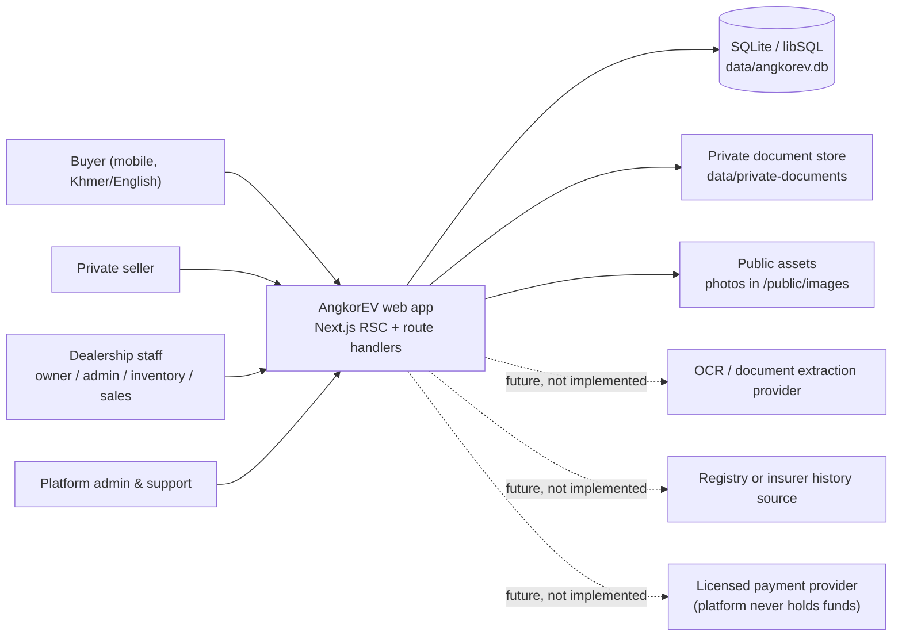
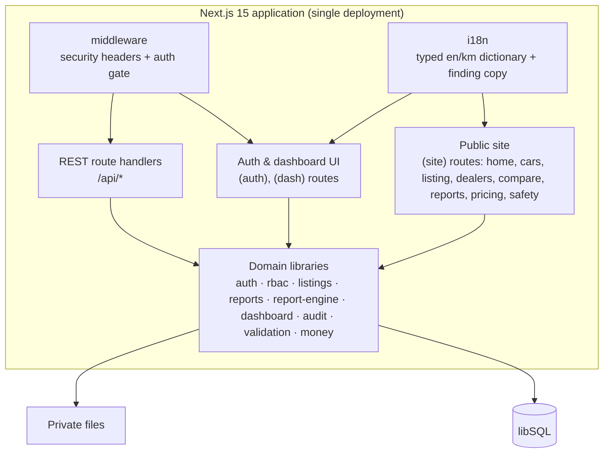
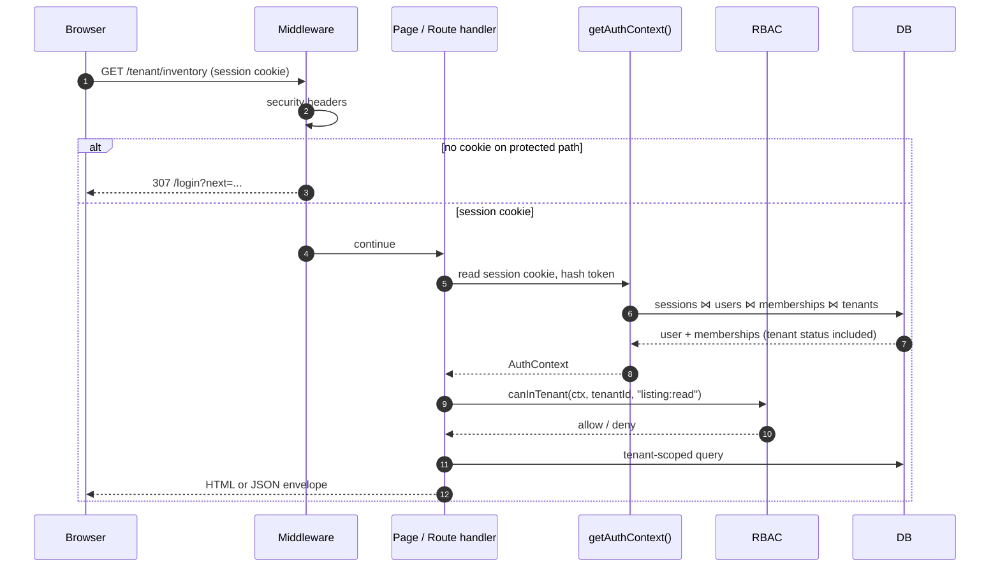
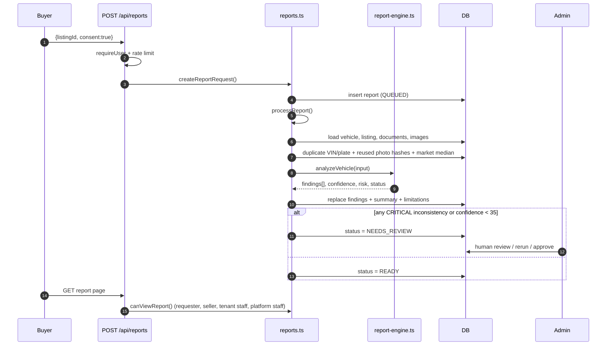
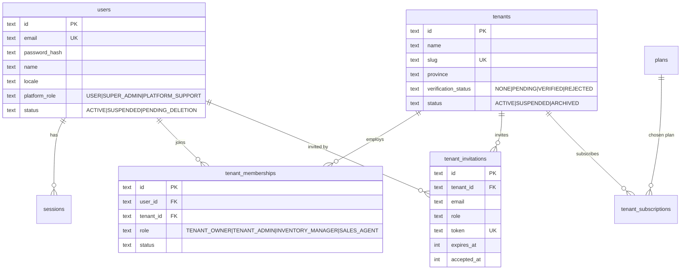
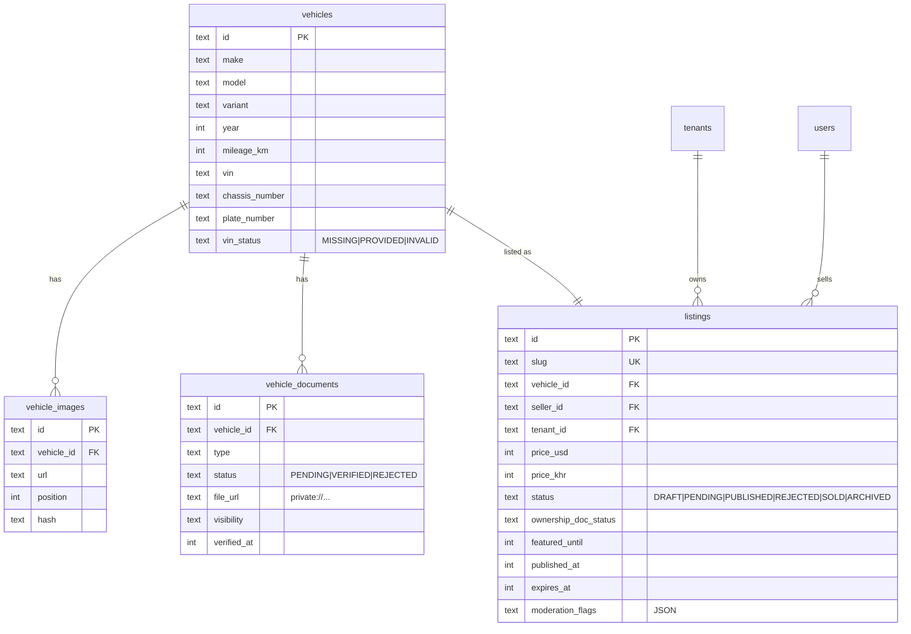
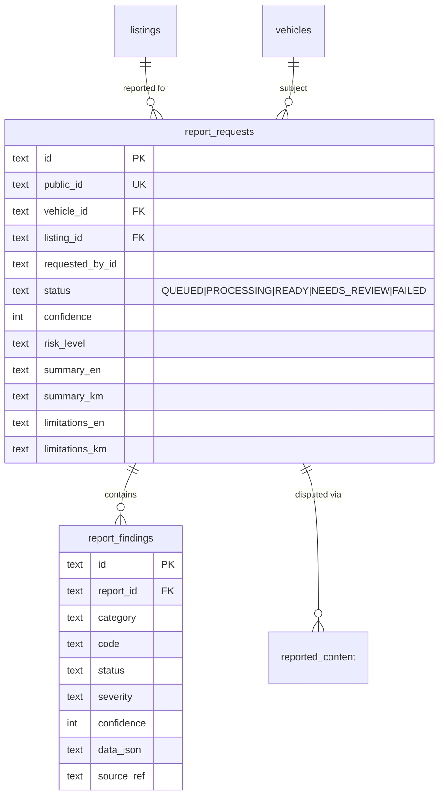
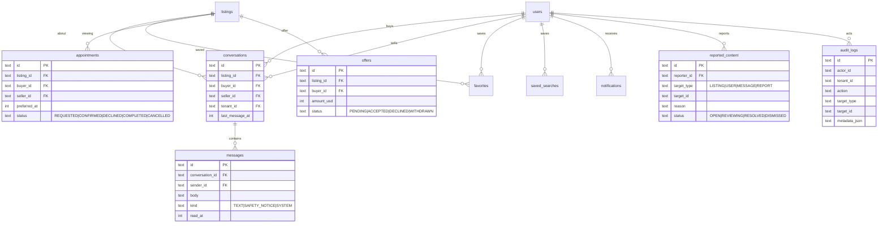

# Architecture

**Shape:** modular monolith (Next.js App Router) + SQLite/libSQL for the prototype.
**Constraint:** no Kubernetes, no microservices, no paid infrastructure at MVP. The same code should run on a single small VM.

---

## 1. Principles

1. **Tenant identity comes from the session, never from the request body.** The body may name a tenant, but it is only honoured if the authenticated user has an active membership (or is a super admin acting deliberately).
2. **Defence in depth.** Layout guards, route guards, shared RBAC helpers, tenant-scoped queries and audit logging. Postgres RLS is the production target; SQLite has no RLS, so the prototype enforces isolation in the service layer and proves it with tests.
3. **Documents are private by default.** Uploads go outside `public/`, are downloaded only through an authorised route, and are never embedded in a public page.
4. **Reports are computed, not recalled.** The rules engine only emits findings from data the platform holds: submitted documents, identifier formats, photo hashes, duplicate listings, mileage claims, and comparable prices. No LLM is asked to invent history.
5. **Everything sensitive is auditable.** Role changes, suspensions, document decisions, report reviews and tenant settings write to `audit_logs`.
6. **Revenue features must not require holding customer money.** No escrow, no wallet, no split payments in the MVP.

---

## 2. System context



**What is deliberately absent:** government registry APIs, insurer APIs, auction-history feeds, e-signature, escrow, lending and insurance. These are research/negotiation items (see `04-regulatory-checklist.md`).

---

## 3. Containers and modules



### Module responsibilities

| Module | Owns | Key files |
|---|---|---|
| Auth | Sessions, password hashing, cookie, auth context | `src/lib/auth.ts`, `src/lib/password.ts` |
| RBAC | Role matrix, tenant resolution, listing access | `src/lib/rbac.ts` |
| Listings | Search, facets, detail, moderation flags, duplicate detection, price context | `src/lib/listings.ts` |
| Reports | Request lifecycle, input gathering, persistence, access rules | `src/lib/reports.ts` |
| Report engine | Pure rule evaluation, confidence, risk, summary | `src/lib/report-engine.ts` |
| Dashboard queries | Aggregates for seller/customer/tenant/admin | `src/lib/dashboard.ts` |
| Audit | Append-only sensitive action log | `src/lib/audit.ts` |
| i18n | Typed Khmer/English strings | `src/i18n/*` |

---

## 4. Request and authorisation flow



Session handling:
- 32-byte random token, stored only as SHA-256 hash in `sessions.token_hash`.
- 14-day expiry, `httpOnly`, `sameSite=lax`, `secure` in production.
- Suspension and logout revoke sessions. Role changes by a super admin revoke sessions too.
- The active tenant cookie is a **convenience selector**, not an authorisation claim; it is re-checked against memberships.

---

## 5. Report generation pipeline



### Evidence statuses

| Status | Meaning | Never means |
|---|---|---|
| `VERIFIED_BY_SOURCE` | A human-reviewed document or a checked platform record supports this line | That the car is accident-free |
| `EVIDENCE_FOUND` | Supporting evidence exists (VIN format, photo count, price context) | Registry confirmation |
| `POTENTIAL_INCONSISTENCY` | Two pieces of evidence disagree or a claim is implausible | Proof of fraud |
| `NOT_VERIFIED` | A check was possible but has not been completed | That the check failed |
| `NO_DATA` | No data exists to check | That nothing happened |

Confidence is a display of **evidence strength**, not a probability that the car is good. Formula: base 32, +12 per verified document (max +30), +2 per evidence finding (max +12), +6 valid VIN, +5 for ≥5 photos, −8 per inconsistency, −10 per critical, clamped 5–95. Any critical finding forces `NEEDS_REVIEW`.

---

## 6. Data model (ERD)

### 6.1 Identity and tenancy



### 6.2 Inventory and listings



### 6.3 Trust and reports



### 6.4 Marketplace operations



There are 22 tables in total; the diagrams cover the relationships that matter for authorisation and product behaviour. `plans` and `tenant_subscriptions` are billing placeholders only (no payment provider in this build).

---

## 7. Tenant isolation and threat model

| Threat | Control (implemented) | Test |
|---|---|---|
| Owner of tenant A reads tenant B leads | Tenant id resolved from membership; queries scoped by `ctx` tenant ids; page and API guards | `tests/security.test.ts` — cross-tenant reads rejected |
| Spoofed `tenantId` in request body | `canInTenant` / `resolveTenantForRequest` check membership and tenant status; body is never trusted | settings route returns 403 and leaves data unchanged |
| Sales agent escalates to admin | Role matrix; `member:manage`, `tenant:manage` denied to `SALES_AGENT` | RBAC matrix tests |
| Support escalates to super admin | `isSuperAdmin` required for role changes; support has no `user:manage` | 403 on `PATCH /api/admin/users/[id]` |
| Suspended dealership keeps selling | Tenant status checked in membership context, dashboard guard, listing visibility, invitation acceptance | Suspended membership has zero permissions; published listings hidden from search |
| Buyer opens seller's documents | Documents served only through authorised route; owner/tenant/platform checks | 403 for other tenant; 200 for owning dealer |
| Stranger reads a report | `canViewReport`: requester, seller, tenant staff, platform staff only | 403 on dispute endpoint; page renders no data |
| Privilege changes go unnoticed | `audit_logs` append-only writes for sensitive actions | Audit page + seed entries |
| Upload path traversal | Filenames generated by server; `path.basename` on read; private directory outside `public/` | Code review + upload constraints |

### SQLite limitation (documented deviation)

Production should run PostgreSQL with row-level security as an **additional** layer. SQLite/libSQL has no RLS, so this build relies on:
1. a single choke point for tenant resolution,
2. every tenant query including the resolved tenant id,
3. explicit route-level permission checks,
4. the security test suite.

This is acceptable for the prototype, not for a multi-region production deployment.

---

## 8. Performance and low-bandwidth design

- Server components render search and listing pages; the client JS budget is limited to interactive widgets (filters, gallery, compare, uploader).
- Listing images are local, compressed JPEGs; no external CDN dependency; `loading="lazy"` below the fold.
- No web fonts fetched from Google; `@fontsource` is bundled and subset by weight.
- Search has server-side pagination and facet counts; no client-side fetch of the full inventory.
- `data/angkorev.db` is file-backed for demo; indexes cover status/published, tenant/status, seller/status, price, make/model/year, VIN, plate, and image hash.
- Cache headers: public pages can be cached at the edge; dashboards and documents are `no-store`.

---

## 9. Deployment and scaling path

| Stage | Deployment | Database | Files | Reports |
|---|---|---|---|---|
| Prototype (this repo) | One Node process, `0.0.0.0:3000` | SQLite file | Local private folder | In-process rules engine |
| Pilot | 1–2 app instances behind a proxy | Managed Postgres + RLS | Object storage with signed URLs | Queue (e.g. Postgres-backed jobs) + worker |
| Scale | App + worker + read replica | Postgres | Object storage + CDN for public photos | Extraction provider(s) with human review queue |

Scaling triggers (not premature): p95 page > 1.5 s on 3G, DB write contention, > 5k listings, or > 20 concurrent report jobs.

---

## 10. Deliberate technical decisions

| Decision | Why | Trade-off |
|---|---|---|
| Next.js modular monolith | One deployable, shared types, simple auth/cookies, low cost | Not independently scalable per module yet |
| Drizzle + libSQL instead of Prisma | Prisma binaries could not be downloaded in the build environment; Drizzle is SQL-first and portable to Postgres | Hand-written SQL migration (`schema.sql`) |
| SQLite for the prototype | Zero-ops, file-based, adequate for demo | No RLS, limited concurrency; Postgres required for production |
| Rules engine, no LLM | Cannot fabricate history; deterministic, testable, free | Less "magical"; must be paired with human review |
| Mock AI provider seam | Keeps the interface for future extraction without pretending it exists | Provider is `rules-v1` only |
| No payment holding | Avoids NBC licensing and consumer-fund risk | Monetisation must be invoiced/subscription-based initially |
| Documents outside `public/` | Prevent accidental public exposure | Requires an authorised streaming route |

---

## 11. Operational runbook (prototype)

```bash
npm run setup       # apply schema + seed demo data
npm run typecheck   # strict TypeScript
npm test            # security regression suite
npm run dev         # 0.0.0.0:3000
```

- Health: `GET /api/health` returns database connectivity and version.
- Reset demo: `npm run db:seed` (refuses when `NODE_ENV=production`).
- Logs: report engine failures are logged and the report is marked `FAILED` rather than silently left `PROCESSING`.
